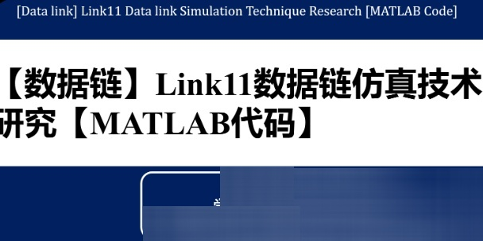

# Data Chain: Research on Simulation Technology of Link11 Data Chain [MATLAB Code]

1. Regular Link11 Waveform
The Link11 audio signal is divided into two categories: leading signals and data signals, all of which are segmented into frames, with the length of each frame depending on the data rate. Link11 supports two frame lengths, determined by the available data rate. The typical rates are fast and slow. The fast rate transmits at a speed of 75 frames per second (approximately 13.33ms per frame), while the slow rate transmits at a speed of about 45.45 frames per second (approximately 22ms per frame). Each data frame contains 30 bits of information.
A data frame consists of an audio signal composed of 16 single tones, with the frequency of each tone being the odd harmonic of 55Hz. Out of these 15 audio signals, 14 are used for binary encoding information, where the phase in one frame signal does not change. At the end of the signal frame, the corresponding phase changes, then new phase values are maintained in the next frame signal without changing the phase. The sixteenth single tone is a 605Hz tone, similar to the leading code frame, with the capability of 605Hz tone being 346dB higher than other tones. During signal transmission, the phase of the tone does not change, nor does it experience phase shift.
The 16 audio signals form the radio carrier, with the signal frequency range being 600-3000Hz. Here, the 16 audio signals correspond to frequencies between 935-2365Hz, with a frequency difference of 110Hz between each audio signal. The additional audio is located between 605-2915Hz, with a frequency deviation of ±0.1Hz. Among the 15 audio signals, 14 are used for intelligence data, which are transmitted through phase modulation. The frequency of 605Hz signal will not be modulated during transmission, playing a role in Doppler correction.
In the Link11 data signal, information encoding utilizes Differential Quadrature Phase Shift Keying (DPSK) modulation. Each frequency has its unique phase during the frame period. During the transition from one frame to the next, the phase changes, and the change can be represented by a binary number. This binary number is 2 bits long, which can have combinations of 00, 01, 10, and 11. Among these combinations, the corresponding combination is closely related to the corresponding phase. In each quadrant, a binary number is determined to represent the corresponding phase difference, and all phase differences in that quadrant are represented by this binary number.

In the Link11 data chain, audio signals are divided into multiple data frames, with each data frame representing 30 bits of data. In the 15 audio signals transmitted, each audio generates a phase shift angle that represents the digital information being transmitted. Within each frame, each data frequency corresponds to a special phase. At the boundaries of each frame, phase shift occurs between the previous and next frames, and the angle directly determines the numerical value of the digital signal.

(2) Monophonic Link11 Waveform

In the SLEW operating mode of the Link11 data chain, it primarily uses 8PSK modulation technology during signal transmission. As shown in Figure 6, the entire process of 8PSK modulation involves converting the signal to be modulated into digital form through serial-to-parallel conversion, then mapping the converted signal to both orthogonal and co-phase levels, filtering the level signals, and finally obtaining the corresponding waveform signal. The obtained signal is multiplied with the carrier to ultimately produce the modulated 8psk signal.

## Images

<!-- PAYMENT_BLOCK -->

## Get this dataset

- Payment link (Stripe): [Buy now](https://buy.stripe.com/3cs8yP7sY87d0vu9AB)
- Payment QR code: 

<!-- /PAYMENT_BLOCK -->
